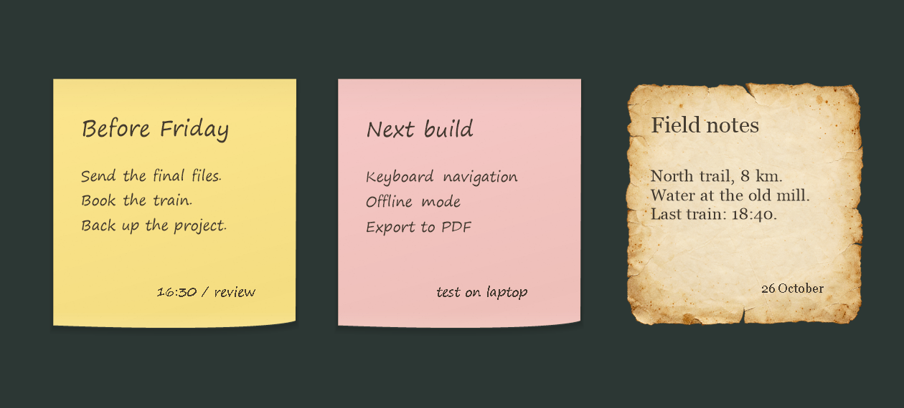

# Paperdesk

Paper notes for your Windows desktop. No dashboard, title bars, taskbar buttons, or permanent controls. Just a few things you wanted to remember.



Paperdesk is a native C++ app with soft shadows, textured sticky paper, and aged parchment with worn edges. It uses Windows' own graphics and text APIs. There is no browser engine, runtime to install, network connection, account, or telemetry.

## Use it

Windows 10 or 11, x64. [Download the latest preview](https://github.com/FerreirAndree/Paperdesk/releases), extract the ZIP, then run `Paperdesk.exe`. The first launch creates a note with a few gestures to get you started. Notes save automatically.

For a stable installation that restores your notes at sign-in, run this from the extracted folder in PowerShell:

```powershell
./scripts/install.ps1
```

This installs to `%LOCALAPPDATA%\Programs\Paperdesk`, adds Start menu shortcuts, and places `Paperdesk.lnk` in the current user's Startup folder. No administrator access is needed. Use `-NoStartup` to skip startup registration. Upgrades replace the old Run registry entry with this shortcut.

| Action | Gesture |
| --- | --- |
| Write anywhere | Double-click empty paper |
| Edit a text block | Double-click the text |
| Finish writing | Ctrl+Enter, or click elsewhere |
| Cancel an edit | Escape |
| Move a note | Alt + drag |
| Move a text block | Alt + Shift + drag the text |
| Scale the entire note | Drag its lower-right corner, or Ctrl + Alt + drag |
| Resize just the text | Right-click directly on a text block → **Text size** → Small, Medium, or Large |
| Change paper, text size, duplicate or delete | Right-click the note |
| Create a note | Launch **New paper note** or run `Paperdesk.exe --new` |

There are three paper styles: butter, rose, and parchment. Text blocks can sit anywhere inside the paper margins and may overlap. Each block wraps toward the right edge. Text that would exceed the paper is rejected, leaving the previous text intact. Resizing scales the whole note between 35% and 200%, including its text, margins, and spacing. It preserves the aspect ratio, block positions, and line breaks. The right-click menu also offers smaller, larger, and original-size actions. Changing a text block's font size is blocked if it would clip the text. There are no scrollbars.

Right-click any remaining note to undo a deleted note during the current session. The previous autosave is also kept on disk. When the last note is gone, the app stays available through its launcher shortcut and command. Paperdesk does not register any global keyboard shortcuts.

## Launchers and commands

After installation, search for **New paper note** in Start or a launcher that indexes Start menu shortcuts. For a launcher such as Raycast, use the executable and arguments below as a command. Paperdesk does not require a launcher extension.

```powershell
& "$env:LOCALAPPDATA/Programs/Paperdesk/Paperdesk.exe" --new
& "$env:LOCALAPPDATA/Programs/Paperdesk/Paperdesk.exe" --new --style parchment --text "Last train: 18:40."
```

| Argument | Effect |
| --- | --- |
| `--new` | Create a note and start writing |
| `--style butter\|rose\|parchment` | Paper for a new note |
| `--text "..."` | Prefill a new note, if the text fits |
| `--restore` | Restore saved notes without taking focus, also the default |
| `--quit` | Save and close the running app |
| `--startup enable` / `--startup disable` | Register or remove sign-in startup |
| `--help` | Show the gesture reference |
| `--data-dir "path"` | Use a separate notes directory and instance |

A second launch sends its command to the existing process. It does not open another copy of your notes. The old `--no-hotkey` flag remains accepted for compatibility, but is no longer necessary.

## Desktop behaviour

Notes are borderless, transparent native windows. They are lowered when another application takes focus and brought back when the Windows desktop takes focus. They do not appear in Alt+Tab or the taskbar. Editing temporarily opens a native text field, then returns to the paper rendering.

This uses documented window and WinEvent APIs, including desktop stacking-order notifications and bounded retries while the shell transition settles. Notes are excluded from Desktop Peek fading. It does not modify your wallpaper, inject into Explorer, reparent windows into `WorkerW`, or send undocumented shell messages. These are still windows. See [desktop integration and known limits](docs/architecture.md) before treating this as a wallpaper extension.

## Your notes

Data stays in `%LOCALAPPDATA%\Paperdesk`:

- `notes.paper` is the current UTF-8 note file.
- `notes.backup.paper` is the previous committed save.
- `notes.pending.paper` is a temporary file during saving.
- A damaged primary file is preserved with a `notes.damaged.*.paper` name if recovery succeeds.
- `last-run.log` records the latest launch, restored note count, readiness, and clean exit. It contains no note text and is overwritten on the next app launch.

The file records paper styles, positions, sizes, text, and block positions. Saves are debounced by 350 milliseconds, flushed to disk, then atomically replaced. Closing an edit, moving a note, and quitting also save. If both the primary and backup are unreadable, the app reports the error and leaves them intact.

Quit Paperdesk before copying a backup over `notes.paper`. These are plain text files, not encrypted storage. The uninstall script removes the app and shortcuts but keeps your notes.

If notes are missing after sign-in, launch **Paperdesk** from Start to restore them. Check that Paperdesk is enabled in Windows Startup apps and that `shell:startup` contains `Paperdesk.lnk`. Run `Paperdesk.exe --startup enable` or rerun the installer to repair its shortcut. A fresh `last-run.log` distinguishes an attempted launch from an app that never started. Windows controls startup timing; verifying registration is not a substitute for testing a real sign-in.

## Build

Install Visual Studio 2022 Build Tools with **Desktop development with C++** and a Windows SDK. Then:

```powershell
./scripts/build.ps1 -Test
./build/Paperdesk.exe
```

Or use CMake 3.24 or later:

```powershell
cmake -S . -B out -A x64
cmake --build out --config Release
ctest --test-dir out -C Release --output-on-failure
```

The C++ runtime is linked statically. A release is a single executable plus documentation and optional install scripts. `scripts/package.ps1` produces a ZIP and SHA-256 checksum. CI builds and tests on Windows.

## Limits and scope

The safety limits are 64 notes, 32 text blocks per note, 4096 UTF-16 code units per block, and 900 × 900 logical pixels per note. These bound memory and file sizes; five or twenty notes do not each start separate processes. Idle notes have no animation or polling loop.

This first version supports typed text, not pen strokes, Markdown, images, reminders with alarms, or syncing. Text editing uses native selection, clipboard, undo, and input methods. Idle paper does not yet expose individual text blocks to screen readers. Multi-monitor and DPI handling are implemented, but need testing on more hardware.

See the [verification report](docs/verification.md) for measurements and tested behaviour, and [CONTRIBUTING.md](CONTRIBUTING.md) for development and the manual checklist. MIT licensed.
